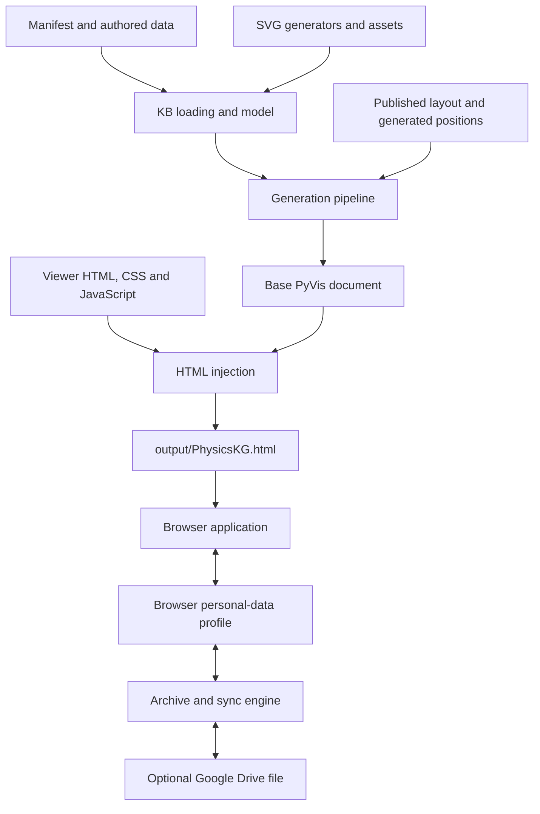

# Architecture

Implementation after the responsibility refactor and domain split (issues 7.2
and 7.3), updated for v4.5.0 and exact-build artifact publishing.
This describes the running code, including remaining coupling. The staged
verification record and comparable source counts are in
[Refactoring progress](refactoring_progress.md). Domain ownership and migration verification are recorded in
[Domain packages](domain_packages.md); deployment migration status is recorded under issue 6.

## System boundary

PhysicsKG is a Python static-site generator plus a browser application. Authored
CSV/YAML/JSON and deterministic SVG graphics become an interactive HTML viewer.
There is no application server or database service operated by PhysicsKG.
The browser holds personal data and optionally synchronises it directly with
Google Drive. Neither browser edits nor sync write back to authored KB files.

The viewer is not a self-contained offline file: vis-network and MathJax load
from CDNs, and the PyVis template references `lib/bindings/utils.js` relative to
the output. Google Identity Services loads on demand for sign-in. Landing, privacy and terms pages, icons and sitemap are
separate website sources under `website/`; packaging places them at the public
root. The small legacy redirect source remains in `output/`. Product identity/version lives in `srkg/branding.py`;
build and presentation defaults live in `srkg/config.py`.

## Authored data and Python generation

`tools/generate_pyvis.py` is the CLI; it parses options and delegates generation
to `srkg/pipeline.py`. The pipeline is the top-level composition point; lower-level
modules should not import it.

| Responsibility | Current implementation |
| --- | --- |
| Resolve root manifests/paths, run common assembly and expose the KB/query facade | `kb.py` |
| Discover selected domain packages, enforce ownership, compose tables/local bibliographies/layouts/tutorials | `domain_sources.py` |
| Resolve semantic namespaces, collect external-reference diagnostics and format generator warnings | `domain_references.py` |
| Discover trusted domain-local Python graphic providers in isolated namespaces | `graphic_providers.py` |
| Brace-aware authored macro parsing without a dependency on loading/diagnostics | `text_macros.py` |
| Authored column/kind contracts and shared loading exception | `schema.py` |
| Fail-fast table/referential checks, independent of I/O and SVG generation | `table_validation.py` |
| Normalise frames and construct typed concepts/modules and caption metadata | `data.py` |
| Optional enrichment of records through the existing SVG registries | `graphic_enrichment.py` |
| Typed content, module, question and reference records; viewer serialisation | `model.py` |
| Editorial/schema diagnostics exposed by `--validate` | `validation.py` |
| Directed graph and module-boundary diagnostics, candidate partition analysis | `dag.py`, `module_diagnostics.py`, `module_partitioning.py` |
| Module anchors, within-module topological ranks/positions, numbering proposals | `module_layout.py` |
| Load/complete the authored global layout; module-free fallback placement | `layout_persistence.py`, `layout.py` |
| Relation colours/direction and module visual identities | `edges.py`, `module_colours.py` |
| Parse/validate declarative tutorial routes and semantic targets | `tutorials.py` |
| Convert prepared graph data to a PyVis network and base HTML | `render_pyvis.py` |
| Inject application assets, escaped JSON data, configuration, branding and MathJax | `html_injection.py` |

The normal generation path is:

1. Resolve `data/manifest.yaml`, discover `domains/*/domain.yaml`, load selected
   package tables and construct `KnowledgeBase`. Explicit selection addresses
   only the named directories without reading other domain manifests/files.
   It contains both pandas graph tables and typed concept/module records.
2. Collection domain selection happens before reading tables or importing graphic
   providers. External targets produce diagnostics and are omitted from graph
   relationships. Apply optional relation filtering to the resulting KB. No build filter edits source data. Common tutorial availability
   is filtered; all retained route targets are validated.
3. Generate module anchors and local concept positions, using authored anchors
   where supplied; complete missing published positions deterministically.
4. Render the base graph with PyVis, then inject teaching content, modules,
   tutorials, layout and the browser application into the resulting document.

Loading performs structural checks through `table_validation.py`, raising the
shared `KnowledgeBaseLoadError`. Existing imports of schema names and the
exception through `kb.py` remain compatible. `load_knowledge_base()` and
`load_knowledge_base_from_paths()` include graphics by default;
`include_graphics=False` retains content, captions, layout and tutorial contracts
without importing or running SVG generators through record construction.
Editorial validation uses this text-only path. This option does not remove any
structural checks or alter authored files.

The richer editorial validation and graph/module reports are separately
requested CLI paths; a normal build does not implicitly run every editorial
diagnostic. Other tools analyse partitions, propose concept
numbering, inspect graphics and explore experimental fine-grained graphs.

`KnowledgeBase` is the loaded query facade. Frozen dataclass records expose
`to_viewer_data()` to define the browser payload; their contained lists/maps and
DataFrames are not deeply immutable. The [KB schema](kb_schema.md) defines durable
input contracts. Semantic IDs identify objects; display numbers and titles are
presentation metadata. Canonical `content_blocks` are the browser's teaching
content. Python retains grouped `Concept.sections` queries for library
compatibility, but the browser payload no longer duplicates them as `sections`.

## Domain ownership and graphics

Every domain owns `domains/<id>/`: its manifest, CSV tables, globally positioned
layout, subject tutorials, Python graphic creators/registry, module SVG assets,
editorial tests/expectations and drafting/source-review documents. The collection
manifest points to a domains directory; there is no central subject/graphic ID
list. Discovery sorts explicit manifests by `(sequence, id)`. `display_name` and
owned `initial_selection` metadata also control browser labels, reading order and
startup without subject-name switches. Module palettes are domain-owned JSON;
shared colour code supplies only a neutral fallback. Semantic IDs and browser storage keys are
unchanged; `math` remains the stable ID while its display label is MATHS.

The recorded source concept owns an edge, including an undirected relation.
Targets and prose cross-references can point into other namespaces. The first
dotted component identifies the owning domain, agreeing with its manifest and
directory. Unloaded namespaces produce structured build warnings; missing IDs
inside loaded namespaces, foreign owners, duplicates and malformed source remain
errors. Unavailable graph edges and support links are omitted; prose stays with
plain, escaped labels. No lookup reads an unselected package. An excluded
package's incoming links are not retained. Bibliography keys resolve within each package
before references are attached to the combined concept records; two domains can
use the same citation key independently.

`domain_sources.py` composes frames in memory and calls common KB assembly;
it never writes combined CSVs. The single-root library/test path uses the same
assembler. Local layout files validate against owned IDs and retain absolute
graph coordinates; per-domain revisions compose into one deterministic published
revision (initial migration retains `7`). Subject routes stay with their authoring
domain; routes with unavailable requirements or command/pointer targets are
omitted with diagnostics. Included-namespace typos and syntax still fail. Common
interface routes stay in `data/` and their availability filtering does not add
artificial subject dependencies.

Each optional graphics provider exports `CONCEPT_CREATORS`/`MODULE_CREATORS`,
mapping owned IDs to functions accepting an icon/detail variant. Providers and
their relative imports load in per-directory Python namespaces without modifying
`sys.path`. `graphic_enrichment.py` adds their SVGs to replacement records;
text-only loading does not import providers. Registrations must name known owned
objects. The compatibility concept/module SVG APIs discover the repository's
providers through the same manifest protocol.

Shared primitives, motifs and landscape framing remain in `srkg/svg_graphics/`.
Domain drawings use them but do not import another domain's creators. Module
motifs/assets and accessible titles live in the owning graphics directory.
SVG output and authored captions are embedded as before; the browser caches
SVG-backed images for canvas drawing and uses SVG in Details.

Authoring/review tools use the composition API. Numbering application and layout
installation require an explicit domain and write only its files. Shared tests
cover contracts and integration; domain-specific fixtures/expectations/tests live
with the domain. See [Domain packages](domain_packages.md) and the
[authoring guide](../authoring/authoring_guide.md) for paths and commands.

## Browser application and rendering

`html_injection.py` embeds `controls.html`, `viewer.css` and helper scripts before
`viewer.js`. Factories are defined before use; dependencies are supplied when the
application initialises after PyVis's `nodes`, `edges` and `network` are ready.
There is no JavaScript bundler, module loader or UI framework. The generated page
retains ordinary local-file opening and its existing external library requests.

`viewer.js` is the composition root and application coordinator. It retains
selection/navigation, module projection and footprint coordination, search,
responsive workspace controls, semantic commands and event wiring. It supplies
query functions and explicit callbacks to closure-based controllers; it does not
pass a mutable universal application-state object between them. Dynamic values
such as selection, OAuth configuration and replaced fold-control maps are read
through callbacks rather than captured once at controller construction.

| Owner | Responsibility |
| --- | --- |
| `graph_model.js` | Stateless context traversal, folded-boundary grouping and shortest-hop Fit++ planning. |
| `vis_network_adapter.js` | All direct `network.body`/`network.canvas` access: precise positions, borrowed geometry, curve points and draw-only widths. Public network operations stay with their callers. |
| `global_layout.js` | Published/personal positions, revision state, debounced persistence and reset. |
| `graph_camera.js` | Panel-aware framing/reveal, animation capability and cancellation of deferred camera restores. |
| `context_layout.js` | Fit/Fit++ priming, temporary coordinates/drag membership and tutorial checkpoints. |
| `layout_geometry.js`, `module_geometry.js` | Stateless collision/position helpers and module footprint geometry. |
| `graph_presentation.js` | Canvas faces, outlines, completion ticks, SVG-image and fitted-label caches. |
| `content_markup.js` | Escaping, references, optional-details markup and math-aware paragraph/caption/study rendering. |
| `details_view.js` | Details replacement/MathJax lifecycle, contents selection and scroll state/timers. |
| `notes_controller.js` | Notes state/editor identity, anchor recovery, rendering and CSV exchange. |
| `study_controller.js` | Questions/read state and indexes, marking, completion caches and scorecard. |
| `personal_data_controller.js` | Connection/import-export UI, OAuth/sync lifecycle and automatic-sync/visibility timers. |
| `tutorial_targets.js` | Live semantic target geometry and concept/edge hover demonstrations. |
| `guided_tutorial.js` | Route/pointer/narration state, input lock, progression and Explore/Resume. |
| `csv.js` | Shared CSV encoding/decoding; callers retain their format-specific strictness and line endings. |

`viewerState` holds context rule, display scope and workspace view. Selection and
folding remain coordinated in the application; camera, personal layout, temporary
layout, notes, study and playback have distinct owners. This is not one immutable
store or a strict MVC implementation. Small compatibility APIs on `window.kg*`
expose existing commands and copied snapshots to tests and tutorial integration;
they are not access to a controller's private state.

The computational graph helpers do not touch DOM, storage or vis-network.
Adapter geometry is borrowed for synchronous reading; callers must not mutate it
or treat it as a durable snapshot. Layout/tutorial snapshot APIs instead copy
their state. Draw-only edge widths bypass DataSet updates to avoid redraw loops.
Controllers expose operations/reload hooks; their caches and timers stay local.
New feature code should use those operations and explicit query callbacks rather
than reading private state from another controller. Register any new factory in
`html_injection.py` before application initialisation, and test behaviour at the
narrowest useful boundary without duplicating authored UI text.

The underlying concept graph is retained separately from its visible projection.
`renderGraphFromViewerState()` computes the context, styles/hides concepts and
edges, then applies the folded-module projection. Boundary relations become
aggregate module edges; a selected concept inside a folded module has a visual
proxy without changing the semantic selection.

The current independent presentation concerns are:

- **Selection:** a concept or module; navigation retains a valid selection.
- **Context rule:** relation/direction traversals plus depth, computed on concepts.
- **Display scope:** All equally, Context + background, or Context only. Internally
  these are `all`, `full` and `context`; `full` means Context + background.
- **Module representation:** folded or expanded, independent of selection.
- **Workspace view:** Graph, Details or Both.
- **Camera:** Reveal, Selection, Context or All framing, and explicit Fit/Fit++.

All equally shows the graph without foreground/background distinction; context
is still available to explicit operations. Context + background emphasises the
selection's context and subdues the rest. Context only omits the rest. Details
links and Show in graph invoke explicit navigation/context actions rather than
silently redefining context as the reader scrolls. Precise behaviour belongs in
[Viewer model](viewer_ui_model.md) and [Viewer behaviour](viewer.md).

Rendering is hybrid: vis-network manages the network, edges, hit testing and
camera; drawing hooks paint concept faces, module graphics, completion ticks and
expanded-module outlines. DOM overlays carry mathematical labels, visible module
fold controls, previews and tutorial targets. MathJax typesets teaching content
and mathematical labels. A draw callback can therefore also update DOM positions.

Performance controls include cached SVG images, module footprints, fitted labels
and completion summaries; deferred construction/typesetting of complex Details
sections; low-zoom simplified concept faces/hidden labels; and batched or scheduled
UI work. Camera animation is reduced on slower devices. These caches require
invalidation when their inputs change; they are not separate application state.

## Layout and temporary presentation

The authored `layout.json` provides global concept positions and module anchors.
Generated positions fill omissions. Browser personal overrides sit above that
base; moving a module moves its members. Module footprints derive from member
bounds rather than a separately authored rectangle.

Fit changes the camera. Fit++ additionally contracts the context using graph-hop
order and collision footprints, retaining the selected anchor. Its coordinates
are temporary, can be adjusted manually, and reset on navigation. Personal layout
editing is an explicit persistent operation. These presentation changes must stay
separate from the authored KB and from the profile's saved layout.
`global_layout.js` owns persistent coordinates; `context_layout.js` owns the
transient Fit++ arrangement. Native canvas movement is not implicitly persisted.
Reset cancels pending saves. Snapshot/capture APIs copy coordinates, and tutorial
restoration uses explicit methods rather than writing another controller's
private variables. See [Layout](layout.md) and [Modules](modules.md).

## Personal data and cloud boundary

`personal_data.js` creates the versioned local-first profile/store, migrates
legacy storage and merges snapshots. Notes, saved layout, study attempts/resets
and reading marks have stable identities and timestamps/deletion or reset records
for merge behaviour. The working profile is JSON in browser localStorage;
`personal_data_archive.js` exchanges a ZIP of readable CSV files. UI preferences
and transient presentation state are not all part of that portable profile.

`personal_data_sync.js` receives a store, archive codec and provider. It reads the
remote archive, merges locally, exports the merged snapshot and writes against a
remote revision, retrying bounded conflicts. Concurrent sync calls share the
active promise. `personal_data_google_drive.js` implements OAuth and the Drive
provider for the visible `PhysicsKG personal data.zip` file using `drive.file`.
Access tokens remain in memory. No developer backend brokers the connection.

`personal_data_controller.js` owns connection controls and automatic-sync timers.
Its merge callback lets the application reload layout/notes/study stores and
refresh summaries without replacing the active Details pane. Expiry pauses sync
and exposes explicit Reconnect/Disconnect choices; local work continues.
Disconnect clears the local connection even offline and retains personal data. Sync application preserves
open Details blocks, notes and study interaction instead of rebuilding the pane
indiscriminately. See [Personal data](personal_data.md).

Built-in blocks, personal blocks and nested explanations use the recursive
`content_markup.js` content-unit renderer: common heading, framed body, child units
and capability-filtered actions. Kind/origin supply colour themes; nesting supplies
placement, and adapters explicitly supply editing/annotation/read-tracking
capabilities. Storage origin does not select a different presentation engine.
See [Content-unit model](notes_content_unification.md). The
notes controller owns reading/editing state and targeted MathJax replacement;
editing one note does not rebuild the Details pane. Personal notes never enter
completion accounting. Notes can attach directly to a concept/module (`placement:
owner`) or target a block (`placement: anchor`), preferably by stable authored `block_id`,
and retain surrounding text to recover paragraph placement after edits. Legacy
anchors migrate when unambiguous; unresolved notes stay stored and are shown as
needing placement. Study and reading summaries feed both Details and optional
graph completion markers.

## Tutorial command and replay boundary

`data/tutorials.yaml` contains validated routes of semantic commands, narration,
pointer targets and optional multi-action cards. `executeViewerCommand()` is the
shared command dispatcher used by tutorials and many ordinary UI actions. It
calls viewer operations directly; pointer animation does not synthesise clicks.
Some DOM handlers still call lower-level functions directly.

`guided_tutorial.js` captures presentation through an application-supplied bridge,
executes semantic commands, resolves targets through `tutorial_targets.js` and
waits for rendering. The bridge coordinates selection, projection, Details,
camera and temporary-layout controllers; playback does not own those states.
Back restores the baseline and replays commands rather than inverting each
action. Explore captures a checkpoint and releases normal input;
Resume restores it, while Exit restores the pre-route presentation. These snapshots
exclude personal-data changes, so exploration does not undo study or notes.
See [Tutorial playback](tutorial_playback.md).

## Design patterns actually present

| Pattern/approach | Evidence and limits |
| --- | --- |
| Pipeline and composition root | `pipeline.py` assembles loading, layout, rendering and injection; the CLI delegates. |
| Typed records and serialization boundary | Dataclasses plus `to_viewer_data()` separate loaded content from the browser payload; graph tables coexist with them. |
| Facades and adapters | `KnowledgeBase` query facade; PyVis rendering adapter; graphics facade/ID registries; Drive provider behind the sync interface. |
| Dependency injection | Controllers receive feature-specific queries, callbacks and collaborators; sync receives store/archive/provider. No DI framework or universal service locator. |
| Functional core with imperative orchestration | Traversal, geometry, layout, merge and diagnostics have computational helpers; file, DOM, canvas and network work surround them. Separation remains incomplete. |
| Projection | Folded modules and aggregate edges derive from the retained concept graph rather than replacing the authored graph. |
| Command dispatch and snapshot/replay | Semantic tutorial/viewer commands and presentation checkpoints; this is not general event sourcing or universal undo. |
| Event-driven controllers and module factories | DOM/vis-network listeners drive closure-based controllers; helper scripts use factories/IIFEs, not an ES-module component tree. |
| Caching and deferred work | Rendering caches, deferred Details construction/typesetting and scheduled refreshes avoid repeating expensive work. |

These are implemented techniques, not a claim that every subsystem follows a
uniform architecture. In particular, `viewer.js` is still the main integration
hub. Projection, geometry coordination and browser event wiring still coexist
there; extracting every helper into a file would not necessarily improve cohesion.

## Verification, delivery and remaining work

Unit tests exercise loading, contracts, layout, diagnostics, graphics, tutorial
validation and HTML injection. Playwright tests exercise generated pages, with a
fast synthetic-data lane and a full lane adding repository content, mobile
emulation and real MathJax. Browser tests are opt-in when their directory is
selected; plain `pytest -q` runs unit tests and skips browser cases. See
[Agent instructions](../../AGENTS.md) for environment and commands.

Publication uses locally built/tested complete-site packages stored as GitHub
Release attachments and deployed unchanged through Actions. Generated viewer HTML
is ignored and untracked. The hosted preview at `/preview/PhysicsKG.html` replaces
GitHack; release/preview updates preserve the other channel. Git history cleanup
remains separate work under issue 6.

The refactor is intended to preserve user-visible behaviour and durable data
formats. Unit/browser coverage includes legacy note-anchor recovery, strict
archive versus lenient legacy notes CSV parsing, layout debounce/reset, sync
without Details replacement, graph algorithms/adapter geometry and all authored
tutorial walkthroughs. Direct algorithm/adapter tests avoid generating a viewer;
full integration tests retain real content and MathJax. CSS keeps its existing
cascade order in one asset; feature tests remain grouped by behaviour rather
than copying the controller directory structure.

`tools/profile_viewer.py` provides a repeatable isolated local Chromium probe
with optional CPU throttling, local vis assets and stub MathJax. Its timings are
observations, not thresholds or a proxy for physical iPad testing. The progress
record gives baseline/final results and the exact source-count scope, including
all extracted files. Smaller `viewer.js` is not itself a reduction in total code.

Domain sources and graphics are physically separate. Missing-domain links now
produce generator warnings and omissions without boundary stubs or automatic
imports. `KnowledgeBase.build_warnings` stores immutable diagnostics and
`missing_domains` derives the sorted set. The CLI groups warnings on stderr;
library loading itself stays silent. Diagnostic CLI modes use the same source
selection. See [selected-domain builds](missing_domain_builds.md). Remaining
application projection/geometry/event coordination is explicit technical debt,
not an incomplete controller contract. Revisit it for a concrete feature or
performance benefit rather than a target file size. Fine-grained pedagogy remains
an experiment; see the
[pedagogy discussion](../discussion/adaptive_pedagogy_and_fine_grained_kb.md).

## Exact-build deployment

`website/` holds public page/branding sources, assembled at the public root.
`output/interactive_graph.html` is the tracked legacy URL page; generated viewers
remain local, ignored build products. `srkg/site_deployment.py` assembles, hashes
and safely verifies complete site packages. `tools/package_site.py` packages
locally; `tools/publish_site.py` uses `gh` to retrieve the live base, upload
Release attachments and request validation or explicit deployment. The Actions
workflow validates with standard-library Python and deploys uploaded bytes without
generating HTML. Release/preview updates preserve the other channel; stale-base
checks and serialized workflows prevent lost updates. See
[Artefact deployment](artefact_deployment.md) for publication/rollback commands.
Pushing source to main does not deploy. Local website inspection can use an
extracted package served over HTTP; direct opening of the generated viewer remains
unchanged. Historical viewer blobs remain pending a separate history rewrite.
