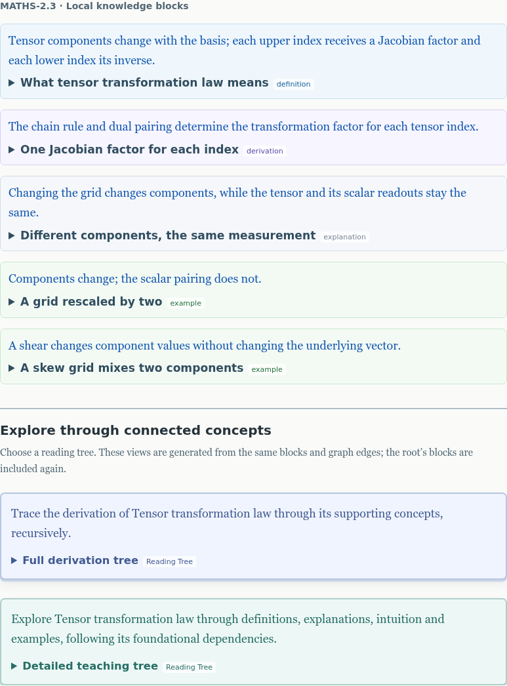
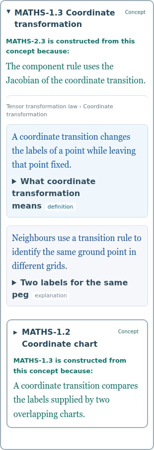
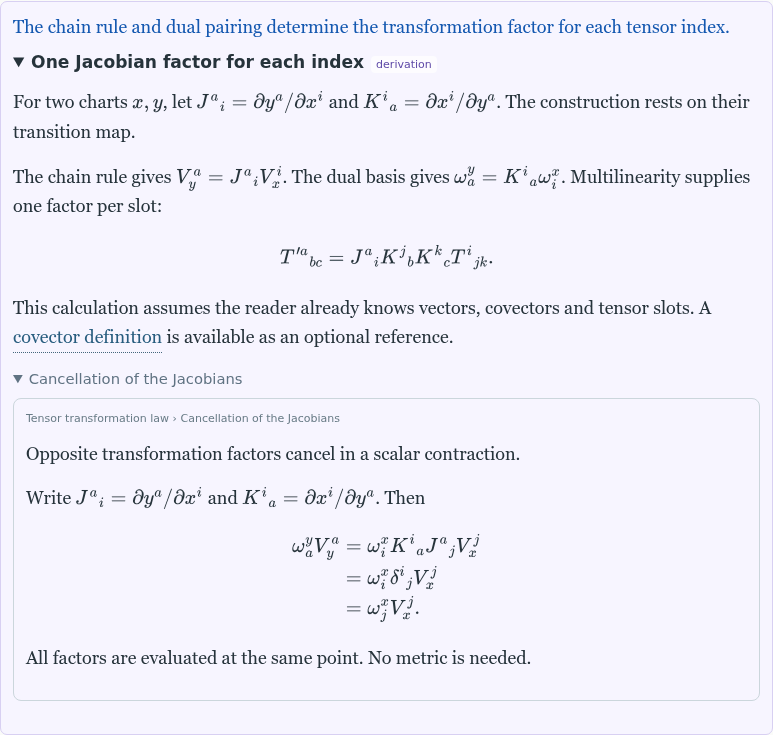

# Blocks and generated reading trees

Agreed design · 11 November 2026.

**Status:** reviewed in the [standalone prototype](../../domains/math/docs/graph_aligned_reading_mockup.html)
([hosted](https://physicskg.org/preview/graph-aligned-reading.html), version 4.6.14).
Implementation in the shared viewer is next, initially building Maths only.
The [schema](folded_reading_trees_schema.md) and
[renderer record](folded_reading_trees_renderer.md) describe the older borrowing
pilot, not this design. The [authoring guide](../authoring/authoring_guide.md)
defines the editorial rules.

## Knowledge is authored; reading trees are generated

PhysicsKG is a KB of linked knowledge elements, not a continuously authored
textbook. A learner can accept a short statement and continue, or inspect its
support. The graph is the map of those supports; the reading tree is a recursive
view of the same structure. It need not read like a polished linear exposition.

| Element | Contract |
| --- | --- |
| Concept | Owns blocks and outgoing typed edges; always has a Definition, usually a Derivation and an Explanation |
| Block | Stable ID, kind, sequence, **title, statement, body**; authored once and self-contained within its scope |
| Clarification | Local title/body disclosure inside a block; may nest, but has no formal statement or independent block identity |
| Edge justification | Why the source uses the destination; belongs to the incoming relationship occurrence |
| Recipe | Authored generic title/statement, ordered block kinds and outgoing edge types; optional `{concept}` substitution |
| Occurrence | One appearance of a concept/block on a reading path; independent folding, canonical source identity |

**No block calls another owned block**, even within its own concept. Local
clarifications can explain algebra or a subtle step without adding graph hops.
Ordinary `\cref` references preview the canonical Definition; they need not have
a direct graph edge and do not generate dependency branches. They must not hide
premises that belong in the dependency graph.

Each concept's first Definition in authored sequence supplies its reference
preview. Repeated block kinds are allowed. The supported kind vocabulary is not
being pruned in this change.

## One block presentation, two reading recipes

A block's statement and expandable title/body share a pale box tinted by kind.
The statement stays visible; **all bodies start folded**. The kind is a badge,
not a substitute for a meaningful title. Opening must reward the reader with
reasoning, interpretation, detail or illustration beyond the statement.

Local clarifications are quieter: smaller, subdued titles, no statement or badge;
ordinary body prose appears on opening. Statements are blue and edge
justifications teal during development. Structure and labels also identify them.

A concept details page shows its owned blocks, then a visual divider and reading
cards. The cards use the same statement/title/disclosure shell, with separate
tints and restrained shadows to distinguish generated views from knowledge blocks.

| Recipe | Ordered block kinds | Outgoing edges |
| --- | --- | --- |
| **Full derivation tree** | Definition, Derivation | `DERIVES_FROM`, `CONSTRUCTED_FROM` |
| **Detailed teaching tree** | Definition, Explanation, Intuition, Example | Those two plus `REQUIRES` (Foundations) |

Recipe statements:

- **Derivation:** “Trace the derivation of {concept} through its supporting
  concepts, recursively.”
- **Teaching:** “Explore {concept} through definitions, explanations, intuition
  and examples, following its foundational dependencies.”

Within each kind, retain authored sequence. Missing kinds are omitted; if none
match, show a notice and still offer dependencies. Missing legacy statements are
simply omitted, never inferred from the body. Root blocks deliberately appear
again inside each tree. Both cards can remain open independently.



*Prototype 4.6.14: kind-tinted local blocks and distinct, initially folded reading
cards. These are design references, not screenshots to refresh each release.*

## Concept branches and graph contract

After a concept's selected blocks, offer every eligible outgoing edge. Each
supporting concept has a stronger container with this order:

1. **Full concept code/name**, including on phones: the heading is its disclosure
   control, with a small Concept badge.
2. Incoming justification, always visible: “A is constructed from this concept
   because: …”, or the corresponding relation-specific wording. Desktop can show
   the source's name; phones show its code.
3. On opening, the destination's selected blocks and its supporting concepts.

Do not repeat a Definition statement ahead of its own block or repeat the heading
inside the body. The justification is specific to this occurrence, not stored as
part of the destination's canonical content.



*The destination is named first; its incoming justification stays visible when
folded. Its Definition statement appears only in the Definition block.*

For a root, recipe and depth, the **available branches**, projected onto concept
nodes/edges, must equal the corresponding Context subgraph. Use the shared graph
algorithm's node and edge sets. Depth is shortest graph distance, not disclosure
nesting. At the boundary retain local content, report further support and offer
explicit depth extension; never extend automatically.

`DERIVES_FROM` and `CONSTRUCTED_FROM` imply the broader prerequisite relation.
Store the strongest applicable dependency, not redundant `REQUIRES` copies.
`COMPONENT_OF`, `INSTANCE_OF` and `RELATED` are outside these recipes. Alternative
derivations need a concrete example before adding route-selection machinery;
the tree currently offers available supports, not necessarily one minimal proof.

## Algorithm

The UI helpers below attach lazy bodies, retain occurrence state and use the
common block renderer. `selected_depth` belongs to the tree. Indentation controls
presentation only; no preferred-block exception remains.

```python
def reading_tree(concept, edge_types, block_kinds, indent=0,
                 ancestors=(), context=None):
    if context is None:
        context = graph_context(concept, edge_types, selected_depth)
        render_root_heading(concept)

    selected = [
        block
        for kind in block_kinds
        for block in concept.blocks_in_authored_order
        if block.kind == kind
    ]
    for block in selected:
        render_block(
            title=block.title, badge=block.kind,
            statement=block.statement or None,
            body=block.body, open=False
        )  # Statement remains visible; body includes local clarifications.
    if not selected:
        render_notice("No matching blocks; dependencies remain available")

    path = ancestors + (concept,)
    for edge in context.outgoing_edges(concept):
        child = edge.target
        if child in path:
            render_cycle_endpoint(child, edge.justification)
            continue

        render_concept_branch(
            title=child.code_and_name,
            justification=edge.justification,  # Visible even when folded.
            open=False,
            focus_allowed=(indent + 1 >= 2),
            on_first_open=lambda child=child: reading_tree(
                child, edge_types, block_kinds, indent + 1,
                ancestors=path, context=context
            )
        )

    if context.has_dependencies_beyond_boundary(concept):
        render_extend_depth_action()
```

Stop ancestor cycles explicitly; allow the same concept on independent sibling
paths. Closing a parent retains its descendants' open state. A missing block kind
does not make an edge disappear. Branch ordering is deterministic from the shared
edge collection; block ordering is recipe kind, then authored sequence.

## Reading position and optional graph synchronisation

**Reading position** is separate from Selection. It follows the concept whose
content the reader most recently opened or explicitly focused within a tree.
Opening a local clarification retains its owner. Closing the current concept
returns position to the nearest visible enclosing concept. Hover does not move it.

When synchronisation is enabled explicitly:

- Selection remains the tree's root.
- Context uses that recipe's edges and the tree's depth.
- A **reading marker** shows Reading position: a steady amber outer ring, separated
  from the existing selection outline by a small gap. Both can coexist.
- If represented by a folded module, mark that module and identify the actual
  concept in its tooltip.
- Do not move the camera, change layout, expand modules or mark content read.

The prototype's map follows the last active tree automatically; this demonstrates
alignment, not the final opt-in control. Before viewer implementation, settle its
default and the detach/resume rule for manual Selection/Context changes. Never
silently present a mismatched graph as the current reading map. Details-only
reading remains valid; opening an ordinary block does not activate a reading tree.

## Depth, persistence and migration

Cap cumulative indentation while keeping concept boxes/path information. Offer
full-width focus from nesting level two, including deeper local clarifications;
Return restores the same DOM, folding and reading location. This is separate from
shortest graph hops.



*The block's statement remains blue. The clarification has a smaller title and
ordinary prose, without a second formal statement or badge.*

Use one renderer for owned blocks and tree occurrences. Read ticks and notes
belong to canonical source blocks and appear consistently in every occurrence;
opening does not mark read. Preserve stable block IDs and named clarification
slots so existing notes/progress remain attached. Personal notes remain private;
persistent reading paths are deferred.

Existing content remains loadable during migration. Remove earlier authored
block-borrowing calls as that content is audited; do not infer replacement edges
from those calls. Preserve note placement, equation rendering and tutorial targets.
A selected-domain build reads only selected packages: keep existing missing-domain
warnings/omission rules, and state map/tree guarantees for the loaded edition.
Never inspect an excluded package to complete a reading branch.
