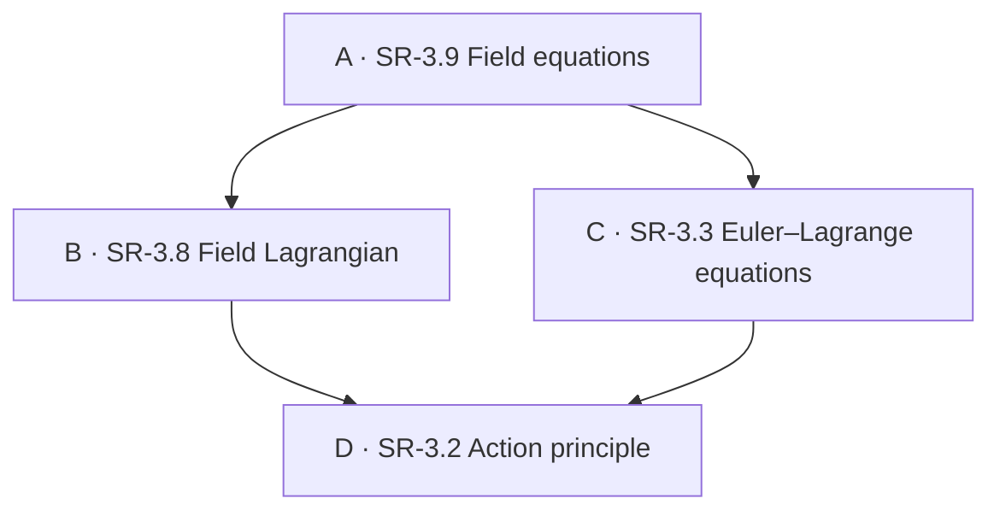

# Nested explanations — paper prototype

Historical exploration. The [Maths pilot design](folded_reading_trees_design.md)
incorporates subsequent decisions, including direct reading of native blocks
and mixed-type sharing. Use that document for the next implementation stages;
the states below retain the original Field equations experiment.

Read the [text-only HTML mock-up](folded_reading_trees_mockup.html) to explore the
argument through working disclosures. The design states and proposed graph
behaviour remain documented below.

Remote review: <https://physicskg.org/preview/nested-explanations.html>.
This standalone preview does not replace the hosted viewer or user guide.

Discussion draft, 8 November 2026. This is a proposed reading experience, not an
implementation specification or a change to published physics content. The
example uses real teaching text to test whether recursive sharing produces a
coherent argument and predictable interaction. Read states 0–5 in order, then
try the alternative traversal in §8.

## 1. The experience we want

**Question:** How can a rule comparing whole field configurations produce a
differential equation at each event?

The reader should be able to borrow a clearly stated result, use it immediately,
or unfold its explanation without leaving the unfinished argument. Supporting
material must appear where the argument needs it, with a grammatical connection
to its surroundings. The graph preserves orientation while the page supplies
the reasoning. Opening material never means that the reader has understood it.

The initial exposition is complete with its explanations folded. Expansion
provides justification, clarification or intuition; it must not reveal an
assumption that makes the previously visible claim misleading.

### Vocabulary

Use the existing [content-unit vocabulary](notes_content_unification.md):

- A **content unit** is titled content which can contain other units.
- A **block** is a top-level unit; an **explanation** is a nested unit.
- A **local explanation** is authored within its enclosing argument.
- A **shared explanation** refers to independently maintained content. The same
  source can appear in multiple places; those are distinct **occurrences**.
- A **statement** is the result or claim available without opening its
  explanation. An explanation supplies reasoning, meaning, examples or algebra.
- A **reading target** is the occurrence most recently explicitly opened. Its
  owning concept receives the proposed **reading highlight** in the graph.
  This is distinct from Selection, Context, hover inspection and completion.

“Algebra”, “Why exactly?” and “A physical picture” are descriptive titles, not
different rendering systems. Neither local/shared origin nor intuition/formal
reasoning requires a new reader mode. The statement/explanation distinction
does need explicit structure; it cannot be inferred reliably from arbitrary prose.

## 2. Scope and starting presentation

The selected concept is **A: SR-3.9 Field equations**. Its existing Derivation
edges give this diamond:



Arrows mean “uses a derivation input”, not chronological order. D is one graph
concept and one shared source even when it appears twice in Details. These
concept-level edges already exist; the block-level references below are proposed.

For these drawings the reader has explicitly chosen **Both**, **Context +
background**, **Derivation, 2 hops**, expanded SR-3, and used **Fit context**.
The four concepts are visible. Background objects are omitted from the sketches
only to keep them legible. No disclosure action establishes these settings.

Proposed **Show this argument in graph** would offer this existing context rule,
following the precedent of Show in graph. Expansion remains explicit. This
example does not require a new Graph mode or permanent block nodes.

Mathematical scope: one smooth, unconstrained real scalar field on a fixed
spacetime region, a first-derivative Lagrangian density, and variations vanishing
on the boundary. Differentiation, the product rule and integration by parts are
assumed mathematics, with local algebra supplied below. Gauge constraints,
moving boundaries and higher-derivative theories are outside this argument.
Lorentz covariance requires a suitable choice of action; this variational
calculation alone does not establish it.

## 3. State 0 — the complete short argument

All explanations start folded. `▸` is a closed disclosure, `▾` is open.
`[A]` denotes Selection. Braces mark the reading highlight, whose initial owner
is A. These diagrams show screen structure; the equations immediately below
them are the actual proposed teaching text.

```text
DETAILS                                     GRAPH (fixed throughout)
SR-3.9 Field equations                      Reading: A; Selection: A

From an action to a local rule                       [A]
  Setup and assumptions                              / \
  B: statement; ▸ Where does this action come from?  B   C
  C: statement; ▸ Why does this procedure work?       \ /
  Apply stationarity                                  D
  Field equation
  ▸ Algebra: varying the field
  ▸ A physical picture: many small adjustments
```

### Visible teaching text

**From an action to a local rule**

A field equation tells us which field configurations are dynamically allowed.
Here we ask how stationary action produces such a local rule. Consider one real
scalar field \(\phi(x)\) in a fixed spacetime region \(\Omega\). Hold the field
fixed on its boundary and choose a density depending on \(\phi\), its first
derivatives and, possibly, the coordinates.

**The action we vary.** A field Lagrangian supplies the action

\[
S[\phi]\coloneqq\int_\Omega
  \mathcal L(\phi,\partial_\mu\phi,x)\,d^4x.
\]

This tells us what quantity to compare for neighbouring field configurations.
**▸ Where does this action come from?** *Field Lagrangian*

**The procedure we borrow.** The Euler–Lagrange method varies the unknown
function, integrates derivatives off its variation, and uses the freedom to
vary that function locally. With a stationary action, the remaining coefficient
of the arbitrary variation must vanish.
**▸ Why does this procedure work?** *Euler–Lagrange equations*

Apply that procedure here. We adopt the physical condition that the action is
stationary for every allowed infinitesimal variation of the field. With the
boundary variation zero, the result is

\[
\frac{\partial\mathcal L}{\partial\phi}
-\partial_\mu\left(
  \frac{\partial\mathcal L}{\partial(\partial_\mu\phi)}
\right)
\overset{\text{stationary action}}{=}0.
\]

This is the field Euler–Lagrange equation: it must hold locally throughout the
interior, rather than merely giving one total constraint on the whole region.
**▸ Algebra: varying the field**

The same conclusion has a useful physical picture.
**▸ A physical picture: many small adjustments**

The reader can stop here with two declared borrowed inputs. The explanatory
links are optional, but the assumptions and physical condition are not hidden.

## 4. State 1 — unfold B without leaving A

Open **Where does this action come from?** The statement and local connecting
sentence stay in place. The shared explanation appears immediately beneath
them; it does not repeat the statement or open B's whole concept page.

```text
DETAILS                                     GRAPH
[A] From an action to a local rule           Reading: B; Selection: A
  B: action statement (still visible)
  ▾ Where does this action come from?               [A]
    FIELD LAGRANGIAN · shared from SR-3.8             / \
    A density adds local contributions              {B}  C
    ▸ Why integrate over spacetime?                  \ /
    D: stationary-action statement                    D
    ▸ What does stationary mean?
  C: procedure statement
  ▸ Why does this procedure work?
  ... continuation of A remains below ...
```

### Newly visible teaching text

**Field Lagrangian — a density adds local contributions**

For a particle, an action adds contributions along a history in time. For a
field, the unknown has a value at every spacetime event, so the action adds a
local density over spacetime. Choosing \(\mathcal L\) specifies the theory to
which we will apply the variational principle; the calculus does not choose
that density for us.

**▸ Why integrate over spacetime?**

The role of the action is supplied by the Action principle: the physical history
makes the first-order change in action vanish under allowed variations,
\(\delta S=0\). **▸ What does stationary mean?** *Action principle*

The paragraph introducing D belongs to B's argument. A's phrase “what quantity
to compare” belongs to A's use of B. Neither is generated by pasting a target
title into a generic “requires” sentence.

If the reader opens **Why integrate over spacetime?**, its shared content from
`sr.field_lagrangian.why_density` would say:

> A particle has finitely many coordinates, so its action integrates one
> Lagrangian over time. A field has degrees of freedom throughout spacetime.
> The density supplies the contribution per spacetime volume; integrating it
> adds these contributions into the action for the whole field history.

This explains the construction. It does not imply that integrating an arbitrary
density automatically gives a physically successful theory.

## 5. State 2 — descend to D, a declared physical input

Open B's **What does stationary mean?**. The reading highlight moves to D;
Selection, Context, camera and module representation do not change.

```text
DETAILS                                     GRAPH
[A] From an action to a local rule           Reading: D; Selection: A
  ▾ B: Where does this action come from?
    ▾ D: What does stationary mean?                  [A]
      ACTION PRINCIPLE · shared from SR-3.2          / \
      First-order change vanishes                   B   C
      ▸ Why exactly?                                \ /
  ▸ C: Why does this procedure work?                 {D}
  ... A continues below ...
```

### Newly visible teaching text

**Action principle — first-order change vanishes**

Consider an allowed family of histories \(h_\varepsilon\) passing through the
candidate physical history \(h_0\). Stationarity means, for every such family,

\[
\left.\frac{dS[h_\varepsilon]}{d\varepsilon}\right|_{\varepsilon=0}=0.
\]

Small allowed changes therefore have no first-order effect on the action.
Stationary does not necessarily mean smallest: the action may have a minimum,
maximum or saddle behaviour. Which histories and variations are allowed is part
of the physical problem. **▸ Why exactly?**

If opened, the local **Why exactly?** explanation reads:

> For a sufficiently smooth action along this family,
> \(S[h_\varepsilon]=S[h_0]+\varepsilon a+O(\varepsilon^2)\).
> Stationarity says \(a=0\). It removes the linear change; it makes no claim
> that the quadratic change is positive. This explains the mathematical
> condition. It does not prove that nature obeys the Action principle.

This is an explicit stopping point. We adopt a physical principle and clarify
its meaning; unfolding must not disguise that adoption as a proof. The source
uses generic histories so it can serve both the particle and field arguments.
The enclosing field argument specifies its boundary conditions.

For the sharing test, open this occurrence's **Why exactly?** and leave it open.
Its owning concept is still D, so the graph highlight stays on D.

## 6. State 3 — open the other branch, keeping the first available

Leave B and its D occurrence open. Open **Why does this procedure work?** under
C. The page contains both branches; opening one does not close the other.

```text
DETAILS                                     GRAPH
[A] From an action to a local rule           Reading: C; Selection: A
  ▾ B: ...
    ▾ D: What does stationary mean?                  [A]
  ▾ C: Why does this procedure work?                 / \
    EULER–LAGRANGE EQUATIONS · SR-3.3                B  {C}
    D: stationary-action statement                   \ /
    ▸ What does stationary mean?                      D
    Vary, integrate by parts, use arbitrariness
  ... A continues below ...
```

### Newly visible teaching text

**Euler–Lagrange equations — from a stationary integral to a local equation**

The physical input is again the Action principle: \(\delta S=0\) for every
allowed variation. **▸ What does stationary mean?** *Action principle*

To see the procedure with one unknown function, take a particle path \(q(t)\)
with fixed endpoints and action \(S[q]=\int_{t_1}^{t_2}L(q,\dot q,t)\,dt\).
Its first variation is

\[
\delta S=\int_{t_1}^{t_2}
\left(L_q\,\delta q+L_{\dot q}\frac{d\delta q}{dt}\right)dt.
\]

Here subscripts denote partial derivatives. Integration by parts gives

\[
\delta S=
\left[L_{\dot q}\,\delta q\right]_{t_1}^{t_2}
+\int_{t_1}^{t_2}
\left(L_q-\frac{dL_{\dot q}}{dt}\right)\delta q\,dt.
\]

The boundary term vanishes because \(\delta q\) vanishes at the endpoints.
Inside the interval, smooth variations can be supported in arbitrarily small
regions. For \(\delta S=0\) for every such variation, the bracket must vanish
pointwise. This gives the Euler–Lagrange equation.

**Local bridge back to A, outside the shared content:**

> In our field problem, the varied function is \(\phi(x)\), and derivatives
> run over spacetime rather than time alone. The same variational procedure
> applies. The field-specific algebra below carries out that replacement;
> it is not justified merely by changing the symbols in the particle result.

This is where block-level sharing needs editorial work: the current particle
derivation is spread across several blocks. We must author a coherent reusable
explanation, not concatenate all neighbouring blocks automatically.

## 7. State 4 — the same D through a second occurrence

Open C's **What does stationary mean?**. It displays exactly the D explanation
from state 2, including the same local “Why exactly?” child, initially folded.
Do not maintain another copy of that teaching text.

```text
DETAILS                                     GRAPH
[A] From an action to a local rule           Reading: D; Selection: A
  ▾ B: ...
    ▾ D: Action principle (first occurrence)          [A]
      ▾ Why exactly? (still open)                    / \
  ▾ C: ...                                          B   C
    ▾ D: Action principle (second occurrence)         \ /
      First-order change vanishes                    {D}
      ▸ Why exactly?
    ... C continues ...
```

The first occurrence's state is untouched. Opening or closing “Why exactly?” here
does not change it under B. The source identity is shared; the displayed occurrence and
its disclosure state are not. The graph still contains one D.

The active occurrence gets a modest **Reading** marker at its heading, so the
graph's one D does not leave the reader guessing which occurrence they opened.
An accessible label identifies the source and the enclosing argument. An
optional **Open concept page** link is an intentional navigation action; opening
the disclosure itself never performs that navigation.

## 8. State 5 — return to A and inspect local reasoning

Close C and B, then open **Algebra: varying the field**. Their descendant fold
states are remembered for this page visit. Closing the currently highlighted
branch returns the reading target to its enclosing unit; opening this local
explanation explicitly sets it to A.

```text
DETAILS                                     GRAPH
[A] From an action to a local rule           Reading: A; Selection: A
  ▸ B: Where does this action come from?
  ▸ C: Why does this procedure work?                  [A]
  Field equation                                    / \
  ▾ Algebra: varying the field                       B   C
    Vary the density                                 \ /
    ▸ Why does the derivative move?                    D
    Boundary and local equation
  ▸ A physical picture: many small adjustments
```

### Locally authored algebra

Write a nearby field as \(\phi_\varepsilon=\phi+\varepsilon\eta\), where the
smooth variation \(\eta\) vanishes on the boundary. Define
\(\delta S\coloneqq(dS[\phi_\varepsilon]/d\varepsilon)_{\varepsilon=0}\).
Since \(\delta(\partial_\mu\phi)=\partial_\mu\eta\), the chain rule gives

\[
\delta S=\int_\Omega\left[
\frac{\partial\mathcal L}{\partial\phi}\eta
+P^\mu\partial_\mu\eta\right]d^4x,
\qquad
P^\mu\coloneqq\frac{\partial\mathcal L}
{\partial(\partial_\mu\phi)}.
\]

Integrating the second term by parts moves its derivative onto \(P^\mu\).
**▸ Why does the derivative move?**

The new nested local explanation contains:

> The product rule says
> \(\partial_\mu(P^\mu\eta)=(\partial_\mu P^\mu)\eta+
> P^\mu\partial_\mu\eta\). Rearrange it and integrate:
>
> \[
> \int_\Omega P^\mu\partial_\mu\eta\,d^4x
> =\int_{\partial\Omega}P^\mu\eta\,d\Sigma_\mu
> -\int_\Omega(\partial_\mu P^\mu)\eta\,d^4x.
> \]
>
> The directed surface element \(d\Sigma_\mu\) converts the divergence
> integral into a boundary integral. The minus sign comes from rearranging
> the product rule. The boundary term is zero because \(\eta=0\) there.

The enclosing algebra then continues:

\[
\delta S=\int_\Omega\left[
\frac{\partial\mathcal L}{\partial\phi}-\partial_\mu P^\mu
\right]\eta\,d^4x.
\]

Stationarity requires this to vanish for every allowed variation. Variations
with compact support can be chosen independently in small interior regions.
For a continuous bracket, the fundamental lemma of the calculus of variations
therefore makes the bracket zero at every interior point. This is the displayed
field equation, not a claim that each original contribution to the action is zero.

### Locally authored intuition, available in the same state

Opening **A physical picture: many small adjustments** instead displays:

> Picture a field configuration as values assigned throughout spacetime. We can
> make a small smooth adjustment in one interior region while leaving distant
> values unchanged. If some such adjustment changed the action to first order,
> the configuration would not be stationary. Requiring stationarity against
> every local adjustment forces a local condition. The derivatives in the
> density couple neighbouring values, which is why the condition is a
> differential equation.
>
> These are comparisons between trial histories, not a process in which the
> field searches for the smallest action or communicates instantly across
> spacetime. The picture explains the locality step; it does not replace the
> algebra or establish the theory's causal properties.

This intuition and the algebra explain the same connection. They need not form
separate global traversal modes. Both are local explanations owned by A.

### An alternative study order

A reader wanting foundations first can follow 0 → 1 → 2, close B, then open C
and its justification, before returning to A's field calculation. Another reader
can accept B and C, open A's calculation first, and only investigate a supporting
result when it becomes puzzling. Neither path needs a different page or mode.

## 9. Interaction contract to test

| Reader action | Details result | Reading highlight | Unchanged |
| --- | --- | --- | --- |
| Open a shared explanation | Insert its explanation beneath its already visible statement; retain surrounding prose | Target's owning concept | Selection, URL/history, Context, Graph mode, module folding, layout and camera |
| Open local Algebra / Why exactly? | Reveal locally authored content | That content's owning concept | Same axes as above |
| Open a second occurrence of a shared source | Show the same content with independent fold state | Same graph concept, new active occurrence in Details | First occurrence's state and graph topology |
| Close the active explanation or an ancestor containing it | Hide that branch; retain descendant fold states for reopening | Nearest visible enclosing explanation's concept, otherwise A | Selection and graph presentation |
| Close an unrelated branch | Hide only that branch | Keep the current target | Other open branches and graph presentation |
| Scroll, select text or zoom Details | Ordinary reading | No change: scrolling does not infer attention | Graph state and camera |
| Use Contents to explicitly enter an explanation | Reveal ancestors and position that occurrence below the sticky heading | Its owning concept | Selection and graph presentation |
| Choose Show this argument in graph | Apply the declared context, reveal a graph pane if needed and Fit, following existing Show in graph semantics | Retain current reading target | Selection; modules expand only by explicit action |
| Select another graph concept or choose Open concept page | Normal navigation to that concept's Details | Reset to the new root | Existing rules for explicit Selection changes apply |

Opening a unit sets the target to that unit even if it restores previously open
children. It does not jump the target to the deepest revealed descendant. Closing
an ancestor containing the target resolves the fallback through the occurrence
tree, not through the order in which other units happened to open.

Keyboard activation has exactly the same effects as pointer activation. Disclosure
headings expose their open state. Expansion leaves focus on the activated heading;
it does not jump to a graph node or force a camera movement. Explicit Contents
navigation may scroll Details; ordinary disclosure opening keeps the activation
point stable as far as practical. Long content can extend below the viewport.

### Graph emphasis and exceptional cases

Try a thin dashed outer ring for the reading highlight. Keep Selection's existing
outline and the blue/green completion ticks. Shape, not colour alone, distinguishes
reading. A may have both selection and reading emphasis. No existing edges are
added, removed or recoloured by opening an explanation.

- **Folded module:** emphasise its existing representation and identify the reading
  concept on inspection. Do not replace A's selected face with B's face or imply
  that the module became selected. Offer normal expansion.
- **Off-screen concept:** retain the camera. An explicit Reveal reading target
  action can be considered in the working prototype; automatic panning is excluded.
- **Outside displayed context:** do not silently extend Context. Say that the
  reading concept is outside the displayed graph and offer Show this argument in
  graph. In Context + background an eligible background representation may receive
  the ring without joining the semantic context or changing its counts.
- **Hidden graph pane:** retain the reading target for when Graph is shown; do not
  open the pane automatically.
- **Hover:** existing temporary inspection remains separate. It does not replace
  the reading target; its appearance must remain distinguishable.
- **Phone:** offer the same reading behaviour in Details-only view. Switching to
  Graph reveals the retained reading highlight; Both is optional, not required.

The mock-up should test whether “most recently opened” remains a useful cue after
long scrolling. If not, consider an explicit “show what I am reading” action before
introducing scroll tracking or another persistent mode.

## 10. Content ownership and sharing

This is a conceptual structure, not a proposed CSV/YAML syntax:

```text
A · field-equation argument
  statement + assumptions + connecting prose
  use B · borrowed action statement + local hook → shared B explanation
  use C · borrowed procedure statement + local hook → shared C explanation
  local Algebra
    local Why does the derivative move?
  local A physical picture

B · action-density explanation
  shared same-owner Why a density
  use D · stationary-action statement + B's hook → shared D explanation

C · variational-method explanation
  use D · same stationary-action statement + C's hook → shared D explanation
  particle variation, parts and local conclusion

D · stationary-action explanation
  common statement and meaning of stationarity
  local Why exactly? · first-order expansion
```

A reference occurrence supplies the target identity and its local hook. The
target supplies its canonical statement and explanation. The short borrowed
statement must be an explicitly authored reusable part, not an automatically
extracted first sentence. A's field-specific adaptation of C remains local and
does not silently rewrite C's particle statement. Whether we need named alternate
statements for different audiences is deliberately undecided.

All occurrences use one recursive content-unit presentation. A local child may
later be promoted to a shared unit without changing the reader interaction.
Occurrence identity can follow the root and the chain of reference/child slots;
source identity must remain independent. No concrete identity format is settled.

Opening and closing are transient presentation state, not synchronised personal
data. Preserve them through ordinary rerendering/sync while the page remains
active. Saving whole study journeys between sessions is a separate proposal.
Do not duplicate notes per occurrence or add reading marks merely by expanding.
For the first mock-up, keep existing top-level annotation/completion controls;
independent nested notes and read tracking remain deferred until their ownership
and aggregation rules are decided.

### Existing sources and necessary editorial work

| Unit | Current source blocks | Proposed work, not yet applied |
| --- | --- | --- |
| A | `sr.field_equations.euler_lagrange`, `.particle_to_field`, `.integration_by_parts`, `.local_pde` | Author the coherent short argument, local bridges and nested algebra above; retain other concept blocks separately |
| B | `sr.field_lagrangian.definition`, `.why_density` | Separate a reusable action statement from its explanation; make the use of D explicit |
| C | `sr.euler_lagrange_equations.setup`, `.first_variation`, `.integration_by_parts`, `.arbitrary_variation`, `.result` | Compose a reusable explanation with declared particle assumptions; retain the field bridge at A |
| D | `sr.action_principle.definition`, `.histories`, `.stationary_not_minimum`, `.variation_parameter` | Author a general history-based statement/explanation reusable by B and C, with a local mathematical clarification |

These are source references, not claims that the proposed text already exists as
one shareable block. Nested units currently lack independent stable IDs and the
runtime has no shared-explanation reference mechanism. The existing renderer is
recursive, but identity, reference resolution and block-level dependency semantics
still need design. Display codes in this document are labels, never identifiers.

For a reference back to a source already on the current ancestor chain, show its
statement and “Already explained above” with a return link; do not recurse. Two
sibling occurrences of D are not a cycle. An unloaded-domain reference must keep
its statement readable but disclose that the explanation is unavailable. An
unknown target inside a loaded domain remains an authoring error.

## 11. Review questions before a schema or implementation

1. Does state 0 make a useful argument while honestly declaring what is borrowed?
2. Do the hooks let shared material read naturally in both branches?
3. Can the reader tell a clarification of a physical principle from a proof of it?
4. Does independent disclosure state make repeated content manageable, or is an
   explicit “already open elsewhere” link also needed?
5. Is the reading highlight useful without moving Selection or the camera?
6. Does returning to A feel like continuing an argument rather than recovering
   from navigation? Does this still work in Details-only view on a phone?

The next step, after paper review, is a disposable HTML mock-up of these six
states with real disclosures and a small fixed graph. Test the statement/
explanation split, occurrence state, grammatical continuity and reading highlight.
Only then settle storage syntax, reference resolution, cycle handling and a
production implementation plan. Automatic tutorial generation, new study scores,
audio, general personal-content recursion and new graph modes are outside this pass.
